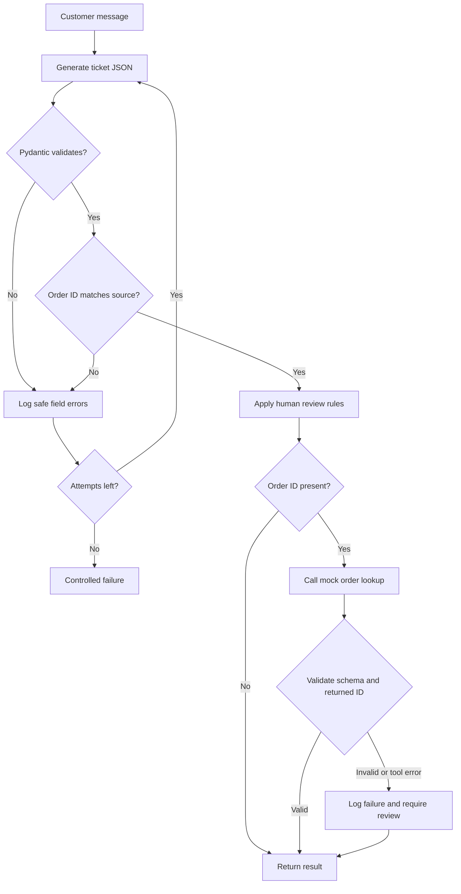

# Structured Output Agent

A beginner Python project that converts support messages into validated JSON.
It demonstrates schema enforcement, tool-response validation, bounded correction
attempts, and structured failure logs.

**Learning objective:** build predictable application behavior around probabilistic
LLM outputs. Schema validity does not establish factual correctness. The controller
also checks order IDs against the source and sends uncertain cases for human review.

## Start here (Windows PowerShell)

Requires Python 3.10 or newer. Run these commands from the project folder:

```powershell
python -m venv .venv
.\.venv\Scripts\python.exe -m pip install -r requirements.txt
.\.venv\Scripts\python.exe app.py
```

You do not need to activate the virtual environment. Default mode is offline and
uses deterministic fixtures, so it requires no API key and makes no network calls.

The default example reports a duplicate charge for ORD-1024. Expect a validated
billing ticket, a mock order status of `paid`, and `status: "needs_review"`.
This is a successful validation outcome that still requires human review.
No refunds, messages, or external actions are performed.

## Try the demos

```powershell
# Valid output accepted on attempt 1
.\.venv\Scripts\python.exe app.py --scenario success

# Invalid priority on attempt 1, corrected on attempt 2
.\.venv\Scripts\python.exe app.py --scenario repair

# Broken JSON on attempt 1, corrected on attempt 2
.\.venv\Scripts\python.exe app.py --scenario parse-error

# Three invalid attempts, then a controlled failure (exit code 1)
.\.venv\Scripts\python.exe app.py --scenario exhausted

# Valid ticket, invalid tool response, human review required
.\.venv\Scripts\python.exe app.py --scenario invalid-tool

# Distinct generation outcomes
.\.venv\Scripts\python.exe app.py --scenario refusal
.\.venv\Scripts\python.exe app.py --scenario incomplete

# Your own input (offline classification uses simple keyword rules)
.\.venv\Scripts\python.exe app.py --message "I cannot log in to my account"
```

The scenario names describe injected fixture behavior, not measured model behavior.
`--max-attempts 2` sets two total generation attempts, including the initial one.
Refusal and incomplete scenarios terminate after one attempt.

## Workflow



1. `app.py` reads CLI options and configures logging.
2. The client proposes JSON using the original message and safe validation feedback.
3. `Ticket.model_validate_json()` rejects malformed JSON, invalid types, extra fields,
   missing fields, unsupported enum values, and out-of-range summary lengths.
4. Python checks the extracted order ID against IDs in the original message. The
   teaching convention is case-sensitive IDs matching `ORD-` plus digits.
   Multiple distinct IDs require null and human review.
5. Invalid model output receives another generation attempt, up to the limit.
   Corrected output passes through the same validation again.
6. A present order ID triggers a local lookup. Its response has its own schema,
   and its ID must match the requested ID. Invalid tool data is never repaired by
   asking the model to invent a replacement.
7. Billing, unclear categories, multiple IDs, unknown orders, and tool failures
   require review. Other validated tickets may return success.

The program is a small controller, rather than an autonomous planner. That keeps
each reliability mechanism visible while you learn.

## Read the code in this order

| File | Purpose |
| --- | --- |
| `schemas.py` | Pydantic contracts for tickets, order results, and the CLI envelope |
| `tools.py` | Read-only mock order lookup and a malformed fixture |
| `llm_client.py` | Offline fixture client, client interface, optional live adapter |
| `agent.py` | Validation, source checks, correction loop, and review routing |
| `logging_config.py` | JSON Lines event logs |
| `app.py` | Command-line entry point |
| `examples/messages.json` | Small labeled learning dataset |
| `evaluate.py` | Offline fixture evaluation |
| `tests/test_agent.py` | Behavior tests for acceptance, recovery, and failure |

`Ticket.model_json_schema()` produces JSON Schema from the Python contract.
`Ticket.model_validate_json(raw_response)` enforces the contract locally.
Strict types prevent accepting a string such as `"true"` as a boolean, while
`extra="forbid"` rejects unexpected fields. Nullable fields still must be present.

## Optional: connect a real LLM

The included adapter uses the OpenAI Responses API with native structured output
and then performs independent local Pydantic validation. Choose an available model
that supports Structured Outputs and the generated schema constraints.

```powershell
$env:OPENAI_API_KEY = "your-api-key"
$env:OPENAI_MODEL = "your-supported-model-id"
.\.venv\Scripts\python.exe app.py --provider openai --message "I was charged twice for ORD-1024"
```

These variables apply to the current PowerShell session. The project does not
automatically load `.env` files. Never commit API keys. Live mode incurs provider
usage charges. The order lookup remains a mock in live mode.

Native structured output constrains format; local validation and source checks
remain useful for application rules. Refusals, incomplete responses, and SDK errors
return controlled failures instead of entering the parse-repair loop. Each live
request has a 30-second timeout and SDK retries disabled. Transient network retries
are a future extension with their own bounded backoff policy.

See the [Structured Outputs guide](https://developers.openai.com/api/docs/guides/structured-outputs)
and [Pydantic models documentation](https://pydantic.dev/docs/validation/latest/concepts/models/).

## Logs and result status

Events append to `logs/validation.jsonl`. Override with `--log-file PATH`.
Each line contains a timestamp, request ID, schema version, stage, and attempt.
Validation failures record field names and error types. Customer messages, model
output, arbitrary extra keys, API keys, and tool exception text are excluded.
The result printed to your terminal does contain extracted ticket information.

| Status | Meaning | CLI exit code |
| --- | --- | --- |
| `success` | Validated ticket does not require review under the demo rules | 0 |
| `needs_review` | Validated ticket requires a person; tool data may be unavailable | 0 |
| `failed` | Invalid input, exhausted validation, or unusable provider response | 1 |
| Setup / CLI error | Missing configuration, bad arguments, or inaccessible log path | 2 |

An invalid tool response produces `needs_review`, retains the validated ticket,
discards invalid order data, and sets `error_code`. An unknown order is a valid
`not_found` response and requires review. No status authorizes a financial action.

## Verify and evaluate

```powershell
.\.venv\Scripts\python.exe -m pytest -q
.\.venv\Scripts\python.exe evaluate.py
```

Tests use offline fixtures and a fake provider SDK; they make no paid model calls.
They check schema violations, retry limits, correction feedback, source mismatches,
review routing, tool errors, refusal/incomplete responses, log privacy, and CLI behavior.

Evaluation reports first-attempt validation, acceptance, recovered case counts,
controlled failure rate, category-and-order matches, and average attempts across
five labeled messages. All results are marked `offline_fixtures_only`:
they verify the controller and are not evidence of live LLM accuracy. For a real
comparison, expand the dataset, label expected answers independently, and compare
prompt-only JSON, native structured output, and the full validated workflow. Report
semantic accuracy, latency, and cost separately from schema compliance.

## Suggested learning exercises

1. Add a new category and observe a previously invalid fixture becoming valid.
2. Add an independent business rule with a test proving invalid data cannot pass.
3. Replace the mock order lookup with a read-only API, preserving response validation.
4. Add bounded retries for transient tool/network errors, separate from model repair.
5. Add a small UI after the CLI workflow is familiar.

A schema-valid summary can still be wrong. Category, priority, and summary accuracy
need labeled evaluation or stronger source checks. A paid order does not prove a
duplicate charge; refund decisions need payment evidence and an approval policy.
